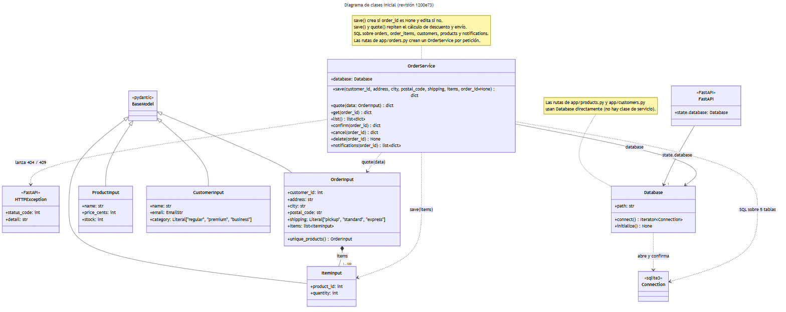
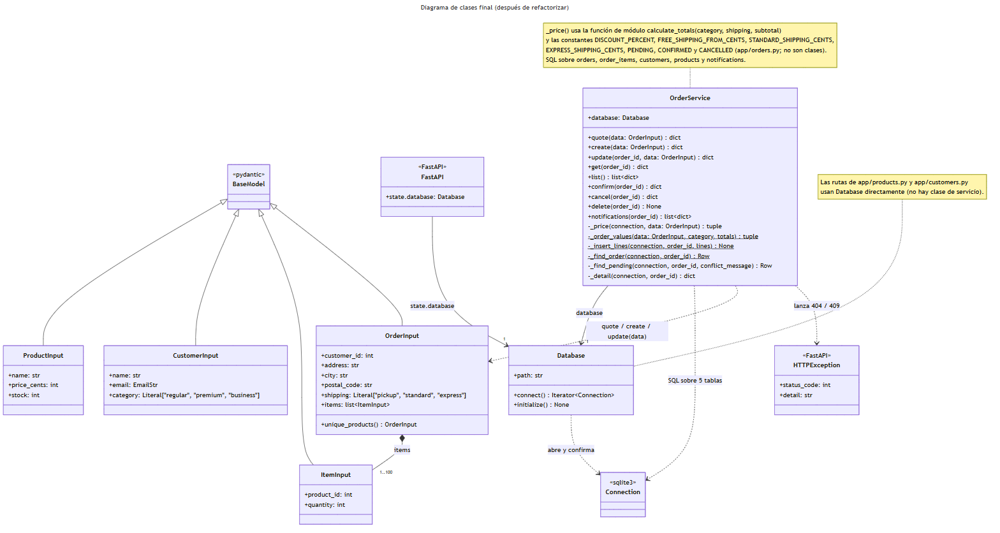

# 6. Diagramas de clases

Los diagramas están hechos en Mermaid (`classDiagram`). Los `.mmd` son la fuente editable; los `.svg` y `.png` son las vistas exportadas.

| Diagrama | Fuente | Vista exportada |
| --- | --- | --- |
| Inicial (revisión `1200e73`) | [clases-inicial.mmd](clases-inicial.mmd) | [SVG](clases-inicial.svg) · [PNG](clases-inicial.png) |
| Final (revisión `57a54df`) | [clases-final.mmd](clases-final.mmd) | [SVG](clases-final.svg) · [PNG](clases-final.png) |

Para regenerar las vistas se usa [mermaid-cli](https://github.com/mermaid-js/mermaid-cli) 11.4.2:

```powershell
npx -p @mermaid-js/mermaid-cli@11.4.2 mmdc -i docs/diagramas/clases-final.mmd -o docs/diagramas/clases-final.svg -b white
```

## Qué se representa

Solo se dibujan **clases reales** del código y las clases externas de las que dependen:
- Del proyecto: `Database`, `OrderService` y los modelos Pydantic `ProductInput`, `CustomerInput`, `ItemInput` y `OrderInput`.
- Externas, marcadas con su estereotipo: `BaseModel`, `FastAPI`, `HTTPException` y `sqlite3.Connection`.

Las rutas de FastAPI son funciones de módulo, así que no aparecen como clases. Lo mismo vale para `calculate_totals` y las constantes de `app/orders.py`: se mencionan en una nota.

| Relación | Tipo | En el código |
| --- | --- | --- |
| `BaseModel <\|-- *Input` | Herencia | Los cuatro modelos heredan de `pydantic.BaseModel` |
| `OrderInput *-- ItemInput` | Composición, 1..100 | `items: list[ItemInput] = Field(min_length=1, max_length=100)` |
| `OrderService --> Database` | Asociación | Atributo `self.database` |
| `FastAPI --> Database` | Asociación | `application.state.database = database` en `main.py` |
| `Database ..> Connection` | Dependencia | `connect()` abre, confirma o revierte y cierra la conexión |
| `OrderService ..> Connection` | Dependencia | SQL directo sobre cinco tablas, incluidas `customers` y `products` |
| `OrderService ..> OrderInput / ItemInput` | Dependencia | Parámetros de los métodos |
| `OrderService ..> HTTPException` | Dependencia | Lanza errores 404 y 409 |

## Diferencias entre el diagrama inicial y el final

| Aspecto | Inicial | Final |
| --- | --- | --- |
| Crear y editar | `save(customer_id, address, city, postal_code, shipping, items, order_id=None)` | `create(data: OrderInput)` y `update(order_id, data: OrderInput)` |
| Dependencia de los modelos | `quote(data: OrderInput)` y `save(items)` reciben `ItemInput` sueltos | Todos los métodos de escritura reciben `OrderInput` |
| Métodos privados | Ninguno | `_price`, `_order_values`, `_insert_lines`, `_find_order`, `_find_pending`, `_detail` (los estáticos aparecen subrayados) |
| Cálculo de precios | Dentro de `save` y de `quote`, duplicado | Función de módulo `calculate_totals` con constantes con nombre (en la nota) |
| Sin cambios | `Database`, los modelos Pydantic, la asociación con `FastAPI`, la dependencia de `HTTPException` y el SQL sobre cinco tablas (ver las limitaciones en [../refactorizacion.md](../refactorizacion.md)) | |




